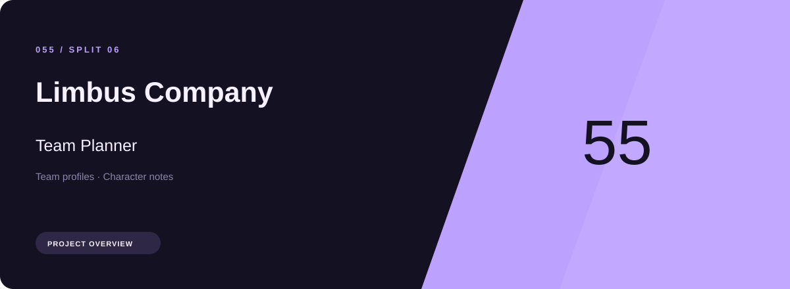
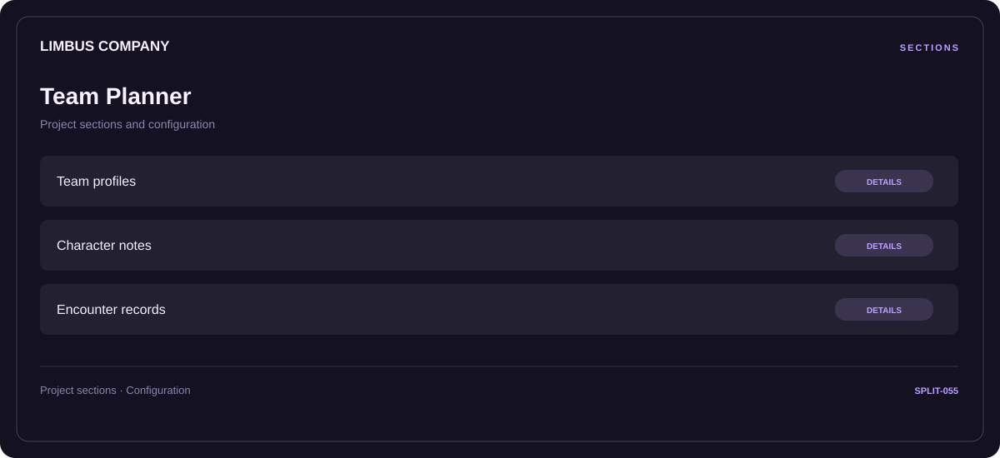

# 🧭 Limbus Company Team Planner

**Team profiles · Character notes · Encounter records**

## ⚡ Features

Limbus Company Team Planner brings team profiles and character notes into one section-based interface. Encounter records provides the third part of the workflow.

### ⚙️ Team profiles

Related settings collected into named groups for a clearer configuration workflow.

### 🧩 Character notes

Character-related parameters and the settings associated with the selected category.

### ⌨️ Encounter records

A dedicated section for encounter records and the configuration details associated with that area.

## 🖥️ Project navigation

## 📥 Download

The button and cover open the project's download page. Use the information supplied with the downloaded package for installation and release-specific requirements.

## 📚 Project documentation

- [Feature reference](docs/FEATURES.md)
- [Download information](docs/DOWNLOAD.md)
- [Project page](index.html)

---

Limbus Company Team Planner · Program documentation and download information.
